# Component Selection - Interaction & Audio Alert

## 1. 5V Voltage Regulator Module

1. L7805ABV-DG (STMicroelectronics 5V 1.5A Linear Regulator)
   
    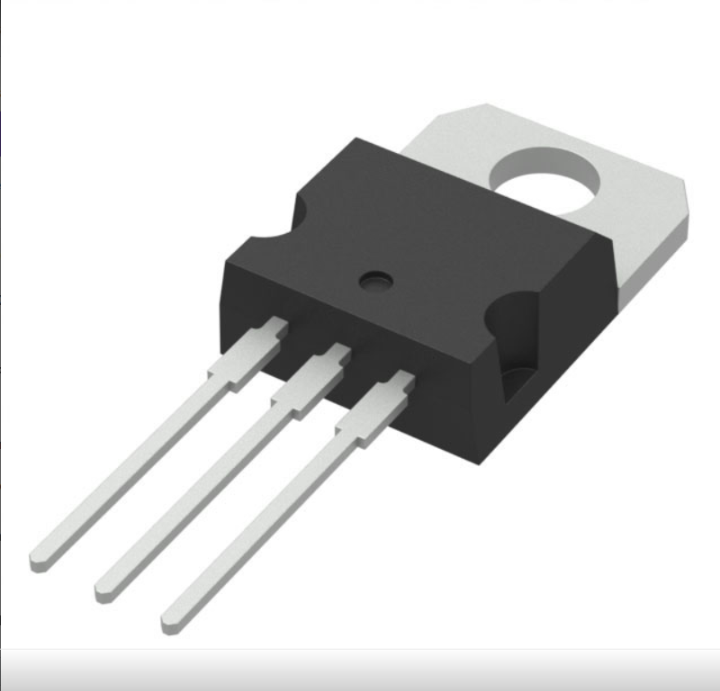

    * $0.88 / each
    * [STMicroelectronics L7805ABV-DG Datasheet](https://www.st.com/content/ccc/resource/technical/document/datasheet/41/4f/b3/b0/12/d4/47/88/CD00000444.pdf)
    * [DigiKey Product Page](https://www.digikey.com/en/products/detail/stmicroelectronics/L7805ABV-DG/3945936)

    | Pros | Cons |
    | --- | --- |
    | Already available on hand (zero additional cost) | Requires thermal consideration under high current draw |
    | TO-220 package allows easy breadboard and through-hole PCB assembly | Linear topology dissipates excess voltage ($9\text{V} \rightarrow 5\text{V}$) as heat |
    | Provides stable $5\text{V DC}$ output up to $1.5\text{A}$, fully powering the PIC18, LM324, and speaker driver | |

2. LM2596S-5.0 (Texas Instruments Buck Switching Regulator)

    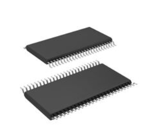

    * $2.50 / each
    * [DigiKey Product Page](https://www.digikey.com/en/products/detail/texas-instruments/LM2596S-5-0-NOPB/363497)

    | Pros | Cons |
    | --- | --- |
    | Highly efficient ($>80\%$) switching conversion | Requires external power inductor, catch diode, and filter capacitors |
    | Low heat generation under heavy load | Higher component count and complex PCB layout footprint |

3. UA78M05CKCS (Texas Instruments 5V 500mA Linear Regulator)

    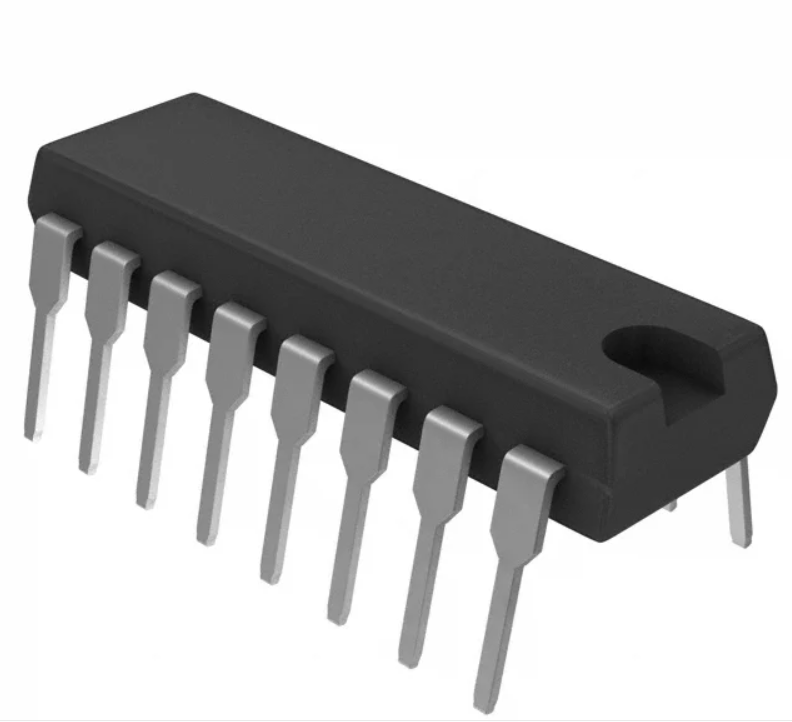

    * $0.72 / each
    * [DigiKey Product Page](https://www.digikey.com/en/products/detail/texas-instruments/UA78M05CKCS/380721)

    | Pros | Cons |
    | --- | --- |
    | Standard TO-220 through-hole footprint | Lower current capacity ($500\text{mA}$) compared to L7805 |
    | Inexpensive and reliable | Marginally lower thermal overhead |

**Choice:** Option 1: STMicroelectronics L7805ABV-DG

**Rationale:** The L7805ABV-DG is already on hand. Because the subsystem consumes under $300\text{mA}$ total continuous current, power dissipation across the regulator is well within safe operating parameters for the TO-220 through-hole package without needing an extra heatsink.

---

## 2. Microcontroller Platform

1. PIC18F57Q43 Curiosity Nano Board 

    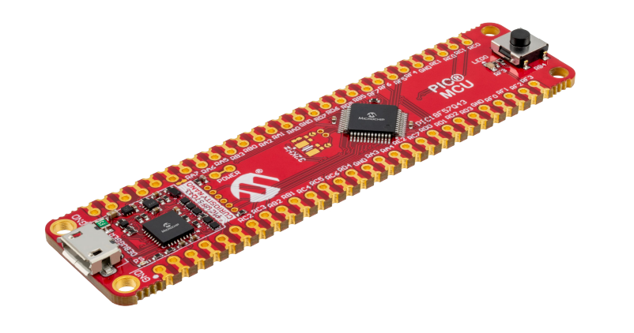

    * Pre-selected Course Requirement
    * [PIC18F57Q43 Hardware User Guide](https://ww1.microchip.com/downloads/aemDocuments/documents/MCU08/ProductDocuments/UserGuides/PIC18F57Q43-Curiosity-Nano-HW-UserGuide-DS40002186B.pdf)

    | Pros | Cons |
    | --- | --- |
    | Required development platform for EGR304 | DIP/through-hole header style occupies larger PCB footprint |
    | On-board PKOB4 programmer/debugger over USB | |
    | Integrated $12\text{-bit}$ ADC (`ADC1`), $8\text{-bit}$ DAC, Configurable Logic Cells (CLC), and PWM peripherals | |

**Choice:** Option 1: Microchip PIC18F57Q43 Curiosity Nano Board

**Rationale:** Core processing board for all team subsystems.

---

## 3. Motion / Pet Detection Sensor

1. Adafruit 189 PIR Motion Sensor Module

    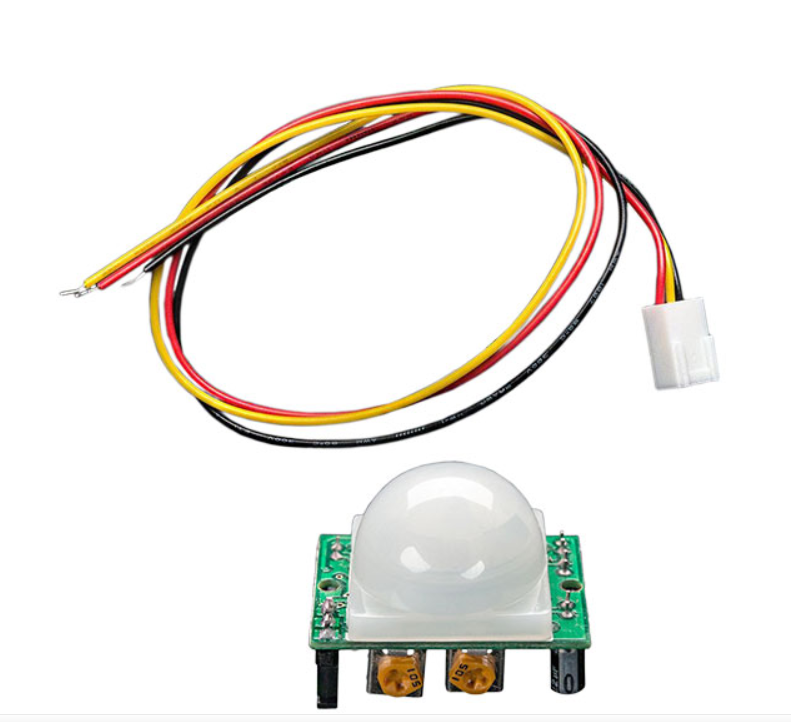

    * $9.95 / each
    * [DigiKey Product Page](https://www.digikey.com/en/products/detail/adafruit-industries-llc/189/6827035)

    | Pros | Cons |
    | --- | --- |
    | Integrated Fresnel lens and signal conditioning circuitry | Higher cost per unit |
    | Provides direct $3.3\text{V/5V}$ digital high output upon motion detection | Larger physical module footprint |
    | On-board sensitivity and delay time adjustment potentiometers | |

2. Photoresistor / Light Dependent Resistor (LDR) 

    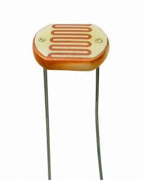

    * $0.00 (Included in provided electronics kit, Item 18)
    * Generic CdS Photoresistor

    | Pros | Cons |
    | --- | --- |
    | On hand; simple voltage divider interface with a $10\text{k}\Omega$ resistor | Sensitive to ambient room lighting variations; requires calibration |
    | Detects light blockage when a pet approaches the feeding dish | Slower optical response time ($20\text{--}30\text{ms}$) |

3. Adafruit 4666 Mini Basic PIR Sensor (BS412 Element)

    

    * $1.95 / each
    * [DigiKey Product Page](https://www.digikey.com/en/products/detail/adafruit-industries-llc/4666/13175534)

    | Pros | Cons |
    | --- | --- |
    | Inexpensive miniature PIR element | Requires external bias resistors and driver circuitry |
    | Ultra-compact metal CAN TO-5 package footprint | Shorter detection range ($3\text{m}$) compared to full modules |
   
**Choice:** Option 1: Adafruit 189 PIR Motion Sensor Module

**Rationale:** The Adafruit 189 PIR Motion Sensor Module provides true infrared thermal detection specifically calibrated for moving bodies, such as owner hand movement or pets approaching the bowl. Because it features built-in signal conditioning and adjustable sensitivity potentiometers, it outputs a clean, chatter-free digital high signal directly to the microcontroller without requiring complex software filtering or sensitivity to ambient room light changes.

---

## 4. Signal Conditioning (Op-Amp)

1. LM324N Quad General Purpose Operational Amplifier 

    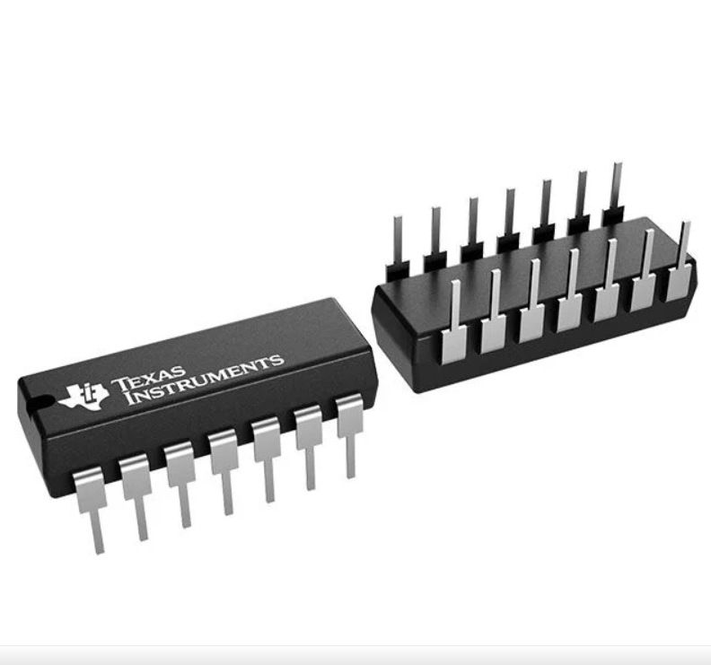

    * $0.82 / each
    * [TI LM324N Datasheet](https://www.ti.com/lit/ds/symlink/lm224.pdf)
    * [DigiKey Product Page](https://www.digikey.com/en/products/detail/texas-instruments/LM324N/277627)

    | Pros | Cons |
    | --- | --- |
    | On hand; 14-pin DIP through-hole package | Not a true rail-to-rail output swing (max output $\approx V_{CC} - 1.5\text{V}$) |
    | Four independent channels allow scaling multiple sensor inputs | Higher offset voltage compared to modern precision op-amps |
    | Operates directly from a single $+5\text{V}$ supply rail | |

2. LMC6484IN/NOPB (Texas Instruments CMOS Quad Rail-to-Rail Op-Amp)

    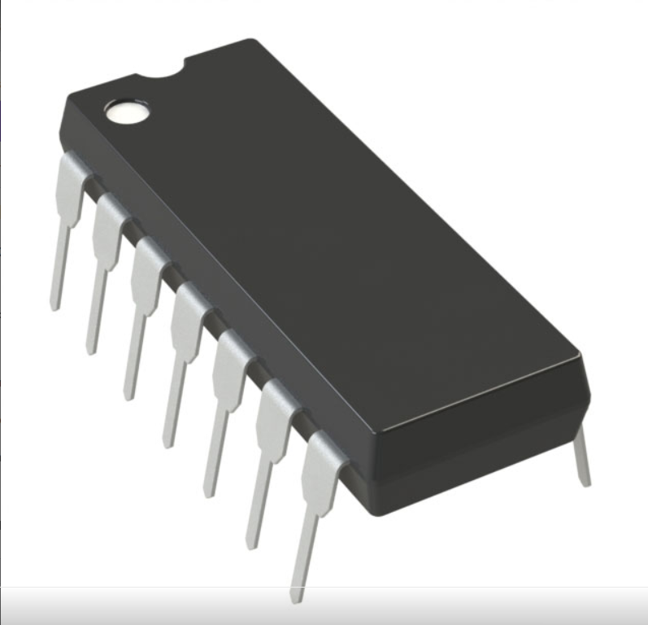

    * $2.35 / each
    * [DigiKey Product Page](https://www.digikey.com/en/products/detail/texas-instruments/LMC6484IN-NOPB/164521)

    | Pros | Cons |
    | --- | --- |
    | True rail-to-rail input and rail-to-rail output (RRIO) capability | Higher unit price than basic general-purpose op-amps |
    | Low input bias current ($20\text{fA}$) and single $+5\text{V}$ supply operation | Requires separate purchase and shipping |
    | 14-pin DIP through-hole package compatible with breadboard testing | |

3. MCP6004-E/P (Microchip Low-Power Quad Op-Amp)

    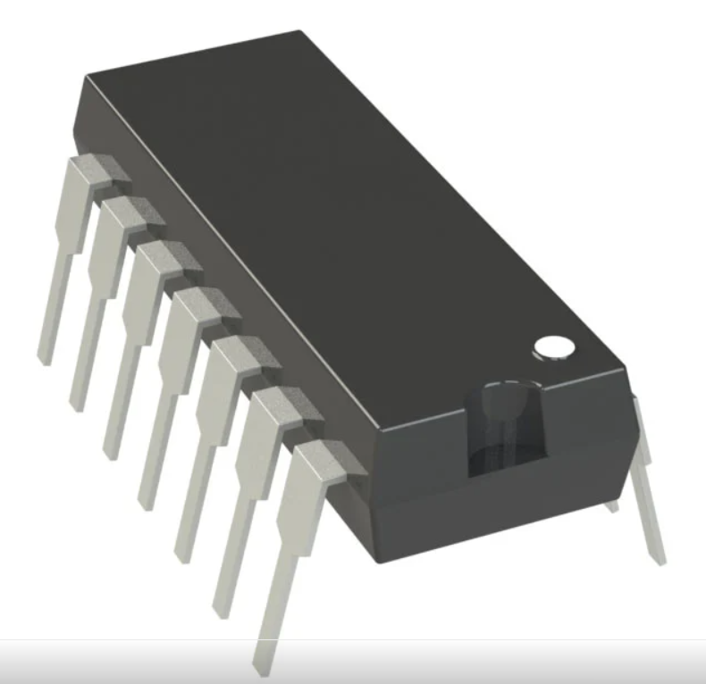

    * $0.98 / each
    * [DigiKey Product Page](https://www.digikey.com/en/products/detail/microchip-technology/MCP6004-E-P/683200?s=N4IgTCBcDaILIGEAKA2ADGgLAWgKIHokQBdAXyA)

    | Pros | Cons |
    | --- | --- |
    | Rail-to-rail I/O optimized for $1.8\text{V}\text{--}5.5\text{V}$ single-supply circuits | Lower gain-bandwidth product ($1\text{MHz}$) |
    | Standard 14-pin DIP through-hole package | Requires additional order |

**Choice:** Option 1: Texas Instruments LM324N

**Rationale:** The LM324N is currently on hand in a DIP-14 package. Configured as a non-inverting buffer/comparator, it conditions auxiliary analog sensor signals into the PIC18F57Q43 `RA0` (`ADC1`) input within the $0\text{--}3.5\text{V}$ dynamic range without requiring external purchases.

---

## 5. Audio Alert Output

1. Soberton Inc. PT-1407 Piezoelectric Transducer

    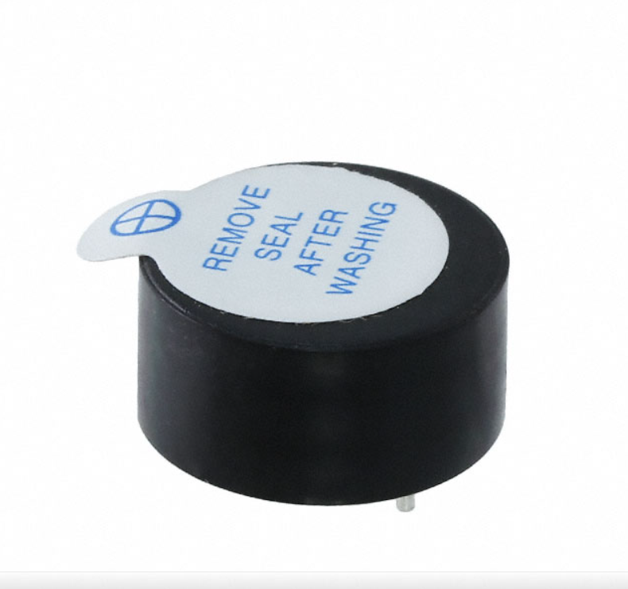

    * $1.18 / each
    * [DigiKey Product Page](https://www.digikey.com/en/products/detail/soberton-inc/PT-1407/1245311)

    | Pros | Cons |
    | --- | --- |
    | Standard $5\text{V}$ operating rating with minimal power consumption ($1\text{mA}$) | Plays narrower acoustic frequency bands compared to dynamic speakers |
    | High acoustic intensity output ($80\text{dB}$ at $10\text{cm}$) | Requires PWM square wave driving signal from MCU |
    | Compact 13.8mm through-hole PC pin footprint | |

2. 8-Ohm Dynamic Speaker + PN2222A NPN Driver Stage *(Currently In-Stock)*

    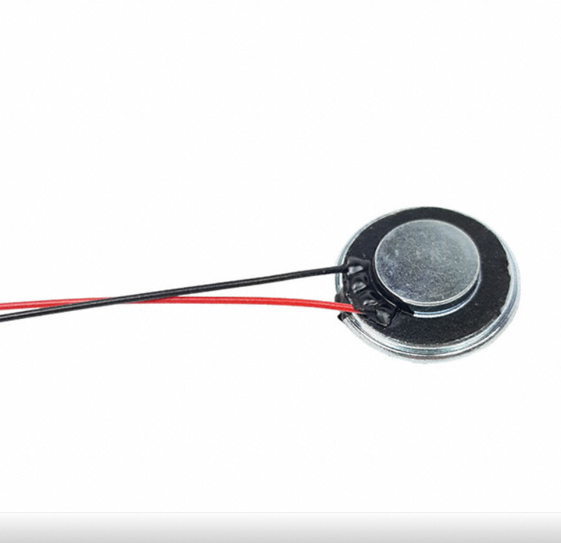

    * $0.00 (On hand component & Kit NPN Transistor, Item 10)
    * [DigiKey Product Page]([https://www.digikey.com/en/products/detail/tdk/PS1240P02BT/935924](https://www.digikey.com/en/products/detail/soberton-inc/SP-2306-1/9924408?gclsrc=aw.ds&gad_source=1&gad_campaignid=20243136172&gclid=Cj0KCQjwlsfWBhD4ARIsACL7p1ENwKsd_tyDLq9xjOjxE6ERBCEwBc_mazVRd1xyyfeqkCz6S3x8tx4aAgGCEALw_wcB))

    | Pros | Cons |
    | --- | --- |
    | On hand; capable of playing complex multi-tone audio meal chimes via PWM | Requires transistor driver stage (PN2222A) due to low coil impedance ($8\Omega$) |
    | Richer tone and higher acoustic output than a piezo buzzer | Draws higher peak current ($\approx 100\text{mA}$) during tone generation |

3. TDK PS1240P02BT (Piezoelectric Audio Indicator)

    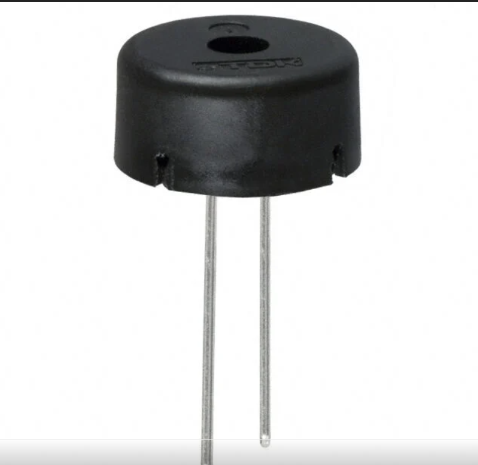

    * $0.73 / each
    * [DigiKey Product Page](https://www.digikey.com/en/products/detail/tdk/PS1240P02BT/935924)

    | Pros | Cons |
    | --- | --- |
    | Compact 12.2mm through-hole footprint | Plays single-frequency high-pitched tones only |
    | Low operating current draw ($<5\text{mA}$) | Requires separate order and shipping time |

**Choice:** Option 1: Soberton Inc. PT-1407 Piezoelectric Transducer

**Rationale:** The Soberton Inc. PT-1407 is selected for its compact 13.8mm through-hole footprint, low $1\text{mA}$ operating current draw at $5\text{V}$, and $80\text{dB}$ sound output. Driven directly by the PIC18 microcontroller PWM pin (`RA1`), it eliminates the need for a transistor driver stage while providing an audible alert chime when feeding routines are triggered.
